<p align="center">
  
</p>

<p align="center"><i>"Statutory compensation for injuries at work."</i> Hong Kong 2026 Policy Address, para 385</p>

<h3 align="center"><a href="https://metricsfile.vercel.app">Try the live demo at metricsfile.vercel.app</a></h3>

<p align="center">
  <a href="https://github.com/KarinaKKarinaK/imperial-hackathon/actions/workflows/checks.yml"></a>
  <a href="https://metricsfile.vercel.app"></a>
  
  <a href="LICENSE"></a>
  
  
  
  
</p>

<p align="center">
  <b>Imperial Global Hackathon Hong Kong and Macau 2026</b> · University track · Challenge 6, open challenge · Team Metrics
</p>

<p align="center">
  <a href="#the-problem">Problem</a> ·
  <a href="#how-it-works">How it works</a> ·
  <a href="#the-crash-detector">Detector</a> ·
  <a href="#roadmap">Roadmap</a> ·
  <a href="#hardware">Hardware</a> ·
  <a href="#market-research">Market</a> ·
  <a href="#business-model">Business</a> ·
  <a href="#privacy-and-governance">Governance</a> ·
  <a href="#evidence-base">Evidence</a> ·
  <a href="#run-it-locally">Run it</a>
</p>

<p align="center">
  
</p>

<p align="center"><sub>Detector numbers: UMAFall, 625 trials, 5-fold leave-subjects-out, threshold 0.5. Every number describes the model the site runs, trained on UMAFall plus synthetic rider windows. Full table with 95% confidence intervals in <a href="ml/out/results.md">ml/out/results.md</a>. <a href="ml/VALIDITY.md">How we checked</a>.</sub></p>

Hong Kong is about to make delivery platforms liable for rider injuries. Nobody records the crash. **Metrics** is the missing record: a HK$110 helmet clip and the rider's own phone detect a crash, wait 30 seconds for the rider to say they are fine, then send location and a likely trauma profile to dispatch. The same event becomes a signed record that names the app active at impact, so an insurer can pay a fixed amount within a day and liability between platforms becomes a lookup, not a court case.

We are the sensor, the trigger and the data standard. We are not the insurer.

---

## For the judges

Imperial's suggested workflow is effectively the marking scheme. Here is where each step lives.

| Step | What Imperial asked for | Where it is |
|---|---|---|
| 1. Evidence base | Ten or more peer-reviewed sources, scale and burden, the named gap | [Evidence base](#evidence-base), [docs/research/EVIDENCE_TABLE.md](docs/research/EVIDENCE_TABLE.md), [docs/research/MARKET_REFRAMING.md](docs/research/MARKET_REFRAMING.md) |
| 2. Design and build | Research-grade prototype, replicable methods, failure modes | Live site, [ml/](ml/), [firmware/](firmware/), [hardware/](hardware/), [What this does not prove](#what-this-does-not-prove) |
| 3. Validate and stress-test | Real or simulated data, sensitivity, uncertainty, honest limits | Bootstrap CIs, leave-subjects-out folds, a synthetic rider set it never trained on, threshold sweep, [validation/](validation/) |
| 4. Translation | Regulatory path, financial model, stakeholders, risk register | [Business model](#business-model), [docs/research/INSURANCE_MODEL.md](docs/research/INSURANCE_MODEL.md), [docs/research/GOVERNANCE.md](docs/research/GOVERNANCE.md) |

**STEMB convergence.** Engineering builds the detector and the app. Natural sciences builds the helmet clip and the drop rig. Medicine sets the triage bands from head-impact literature. Business designs the parametric trigger and who pays whom. Law maps the record to the proposed regime and the privacy ordinance. Take any one out and the record stops being usable by the people who need it.

**Why open challenge.** Occupational injury of platform workers is not ageing, AI governance, green tech, TCM or infrastructure. It sits in Challenges 1 to 5's blind spot and is anchored in para 385 of the 2026 Policy Address.

---

## The problem

| | |
|---|---|
| **The promise** | The 2026 Policy Address (para 385) commits to statutory injury compensation for delivery platform workers. The July 2026 proposal makes platforms liable on a no-fault basis and splits liability when a rider works for several apps at once.[^lwb] |
| **The gap** | No objective record exists of when, where or how a rider got hurt, or which app they were working for at that second. About a third of Hong Kong riders work for more than one platform.[^csd] |
| **The cost of the gap** | A rider injured in a 2020 typhoon won HK$1.35m from Foodpanda only in September 2025, five years later, in the High Court.[^hro] A 2024 union survey put the share of injured riders who were compensated at 13% (original publisher being confirmed).[^union] |
| **Who is affected** | About 12,900 delivery platform workers holding 18,100 platform jobs in Hong Kong. For 65% it is their main income.[^csd] |

The legislation needs data that does not exist yet. That is the deadlock we break.

---

## How it works

<p align="center">
  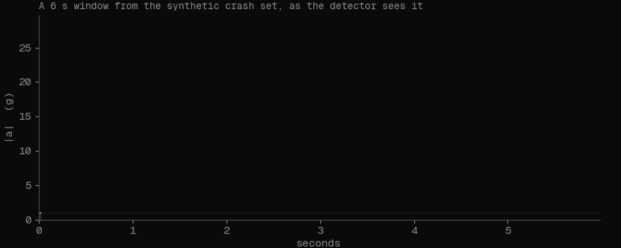
</p>

### System architecture

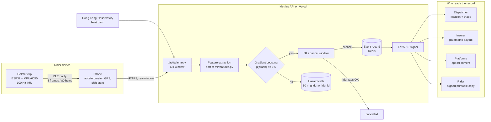

### One crash, end to end

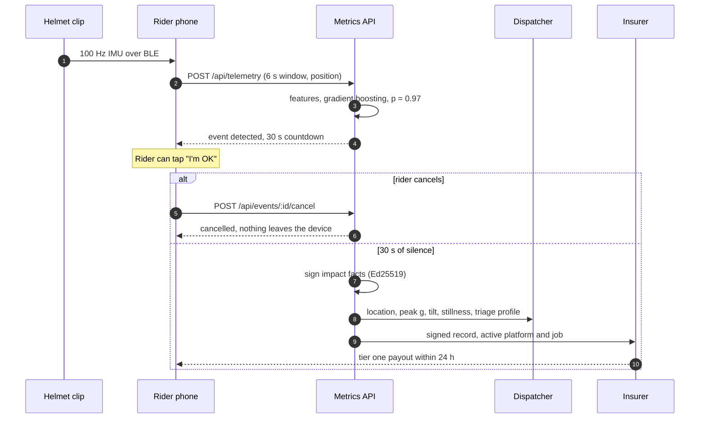

### Event lifecycle

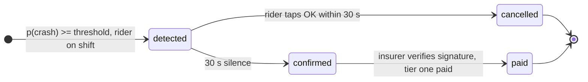

### The record is the standard

Every reader, from dispatcher to court, reads the same schema. It is served as JSON Schema at [`/api/schema`](https://metricsfile.vercel.app/api/schema) and verifiable at [`/api/verify`](https://metricsfile.vercel.app/api/verify). Source: [web/src/lib/schema.ts](web/src/lib/schema.ts).

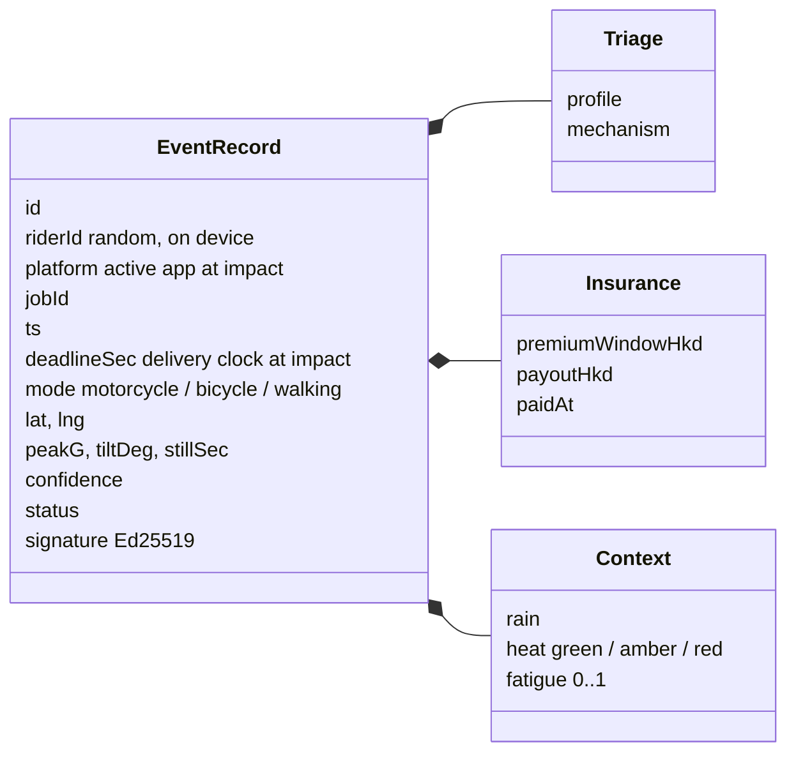

Two fields matter most for the new law. `platform` and `jobId` make multi-platform apportionment a lookup. `deadlineSec`, the seconds left on the delivery clock at impact, is the first dataset that links time pressure to injury.

### Live pages

| Page | What you see |
|---|---|
| [`/`](https://metricsfile.vercel.app) | The pitch, live stats, hardware and the record |
| [`/demo`](https://metricsfile.vercel.app/demo) | Full pipeline on a 3D map of Hong Kong: rider, sensor trace, dispatcher, underwriter |
| [`/rider`](https://metricsfile.vercel.app/rider) | Open on your phone. It streams your real accelerometer to the detector. Drop it on a bed |
| [`/dispatch`](https://metricsfile.vercel.app/dispatch) | Dispatcher view only |
| [`/underwriter`](https://metricsfile.vercel.app/underwriter) | Insurer view only |
| [`/record`](https://metricsfile.vercel.app/record) | The event record, field by field |
| [`/poster`](https://metricsfile.vercel.app/poster) | Printable A0 poster with the STEMB map |

---

## The crash detector

Trained on **UMAFall**[^umafall], a public dataset of simulated falls and daily activities recorded on a phone: 625 trials, 208 falls, 19 people. Every fold holds out whole people, so the model is always scored on someone it has never seen. Each fold trains exactly as the shipped model does, on the training people plus our synthetic rider windows. Confidence intervals are 95% bootstrap.

<p align="center">
  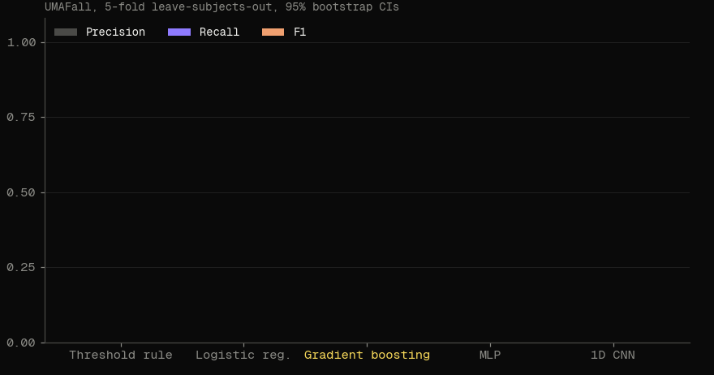
</p>

| Model | Precision | Recall | F1 | AUROC | Brier |
|---|---|---|---|---|---|
| Threshold rule | 0.934 [0.884, 0.979] | 0.476 [0.411, 0.545] | 0.631 | 0.975 | 0.095 |
| Logistic regression | 0.831 [0.778, 0.881] | 0.899 [0.855, 0.938] | 0.864 | 0.944 | 0.082 |
| **Gradient boosting (shipped)** | **0.903 [0.864, 0.941]** | **0.942 [0.911, 0.972]** | **0.922** | **0.987** | **0.037** |
| MLP | 0.866 [0.821, 0.908] | 0.933 [0.897, 0.966] | 0.898 | 0.981 | 0.051 |
| 1D CNN | 0.926 [0.885, 0.961] | 0.841 [0.791, 0.887] | 0.882 | 0.969 | 0.063 |

<table>
<tr>
<td width="55%">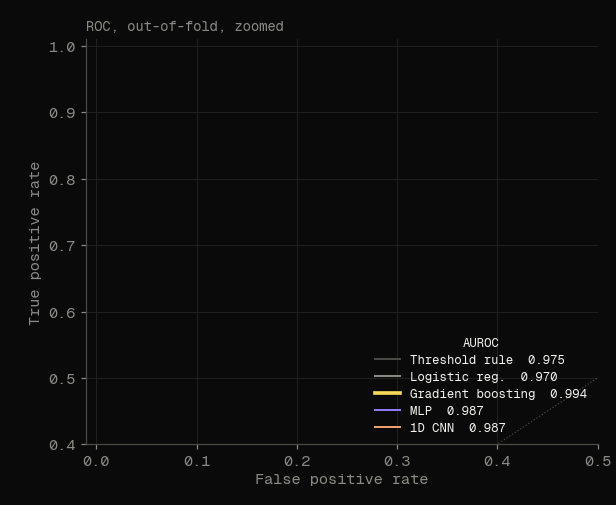</td>
<td>

**Why gradient boosting.** Best F1 and AUROC, best calibrated (lowest Brier), and it is a few kilobytes of JSON that runs in TypeScript on the server with no ML runtime.

**Parity.** [web/src/lib/features.ts](web/src/lib/features.ts) is a line-for-line port of [ml/features.py](ml/features.py). A test checks both produce the same features and probabilities on fixed windows.

**Threshold.** At 0.5: 196 falls caught, 12 missed, 21 false alarms out of 417 non-falls. Most false alarms come from *making a phone call*, which the 30 second cancel window absorbs.

</td>
</tr>
</table>

**Domain shift test.** We score the model on a fresh synthetic draw it never trained on: riding, hard braking, potholes, setting the phone down, dropping a delivery bag, and crashes. It flags 0% of riding, braking, potholes and set-downs, catches 88% of crashes, and still flags 22% of bag drops. Without synthetic windows in training it flagged 97% of bag drops. Bag drops are the open problem the helmet clip is meant to solve.

### Are the numbers real?

We audited our own pipeline ([ml/VALIDITY.md](ml/VALIDITY.md), reproduce with `python3 ml/audit.py`).

| Check | Result |
|---|---|
| Recompute every metric from raw data and from the saved predictions | Identical to the published table |
| Shuffle the labels and rerun the same cross-validation | AUROC 0.47 to 0.54, chance level, so no leakage |
| Could recording length give the answer away? | AUROC 0.52, no |
| Confidence intervals resampling whole people instead of trials | Recall [0.898, 0.971], precision [0.864, 0.953] |
| Worst individual people | Two of the 13 people who fell had a third of their falls missed |
| One feature alone (tilt angle) | AUROC 0.91. Simulated falls are an easier task than road crashes |

### What this does not prove

- UMAFall falls are simulated by volunteers, not real road crashes, and only 13 of the 19 people performed falls. Threshold detectors lose sensitivity on real-world falls.[^bagala]
- Each trial is scored as one window cut around its biggest peak. That is classification, not live detection. Falls are a third of UMAFall and rare on the road, so real-world precision will be lower. False alarms per riding hour are not measured yet.
- The MPU-6050 in the clip is set to 16 g, so harder helmet impacts are capped.
- The synthetic rider set is ours, so the domain shift test is a sanity check, not validation.
- Helmet drop tests are in progress. Protocol: [validation/DROP_TEST_PROTOCOL.md](validation/DROP_TEST_PROTOCOL.md).
- Triage bands come from head-impact literature[^rowson][^zhang] and are not clinically validated.

Retrain with `python3 ml/train.py`. Details in [ml/README.md](ml/README.md).

### What we tried next

Twelve variants, same protocol, nothing chosen on test people. The experiment rows use a different synthetic seed from the shipped row, so compare them with each other. Full write-up: [ml/experiments/RESULTS.md](ml/experiments/RESULTS.md).

| Variant | Recall | Precision | Missed falls | False alarms | AUROC | Synthetic bag drops flagged |
|---|---|---|---|---|---|---|
| Shipped: UMAFall + synthetic, threshold 0.5 | 0.942 | 0.903 | 12 | 21 | 0.987 | 22% |
| UMAFall only, threshold 0.5 | 0.952 | 0.930 | 10 | 15 | 0.994 | 98% |
| + synthetic negatives + 9 new features | 0.957 | 0.930 | 9 | 15 | 0.996 | 19% |
| same, threshold 0.2 | 0.981 | 0.915 | 4 | 19 | 0.996 | 39% |

Synthetic negatives were the only change that moved bag drops. Tuning and calibration did not help. A lower threshold trades four extra false alarms for five fewer missed falls, a good trade when the rider can cancel within 30 seconds.

## Roadmap

From our dataset search and from fields that solved similar problems first. Details and sources: [docs/research/ROADMAP.md](docs/research/ROADMAP.md).

| Next step | Borrowed from | Why |
|---|---|---|
| Helmet and phone must agree within a second | Earthquake early warning networks | A dropped bag moves the phone, not the head |
| Each record carries the hash of the one before | Certificate Transparency | Nobody, including us, can backdate or delete a record unseen |
| Freeze 5 s before and after impact, 200 g sensor | Car event data recorders, concussion mouthguards | Full crash context, no clipping at 16 g, clip sleeps until a hit |
| Cancel taps and hospital records become labels | Weak supervision | Real road crashes replace simulated falls over time |
| Hazard cells divided by rider traffic | Disease mapping | Busy roads stop looking dangerous just for being busy |
| Add head-worn and two-wheeler data | Erciyes head sensor, Boubezoul motorcycle falls, CYCLEGYRO helmet gyro | Moves the model from trouser pocket to helmet and road |

---

## Hardware

A clip that straps through the rear vents of any delivery helmet. It streams 100 Hz accelerometer and gyroscope over Bluetooth to the phone, which forwards the same 6 second windows it would send from its own sensors. The server runs the same model on either source.

<p align="center">
  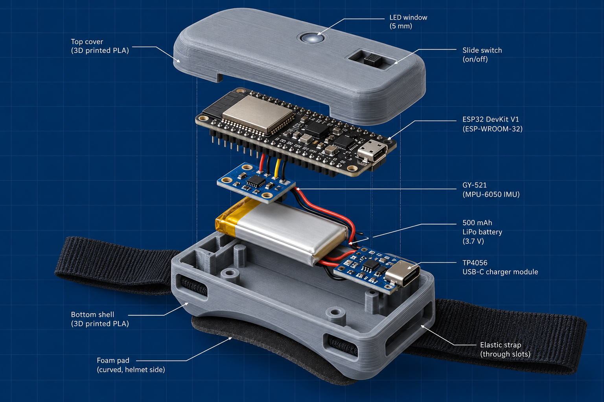
  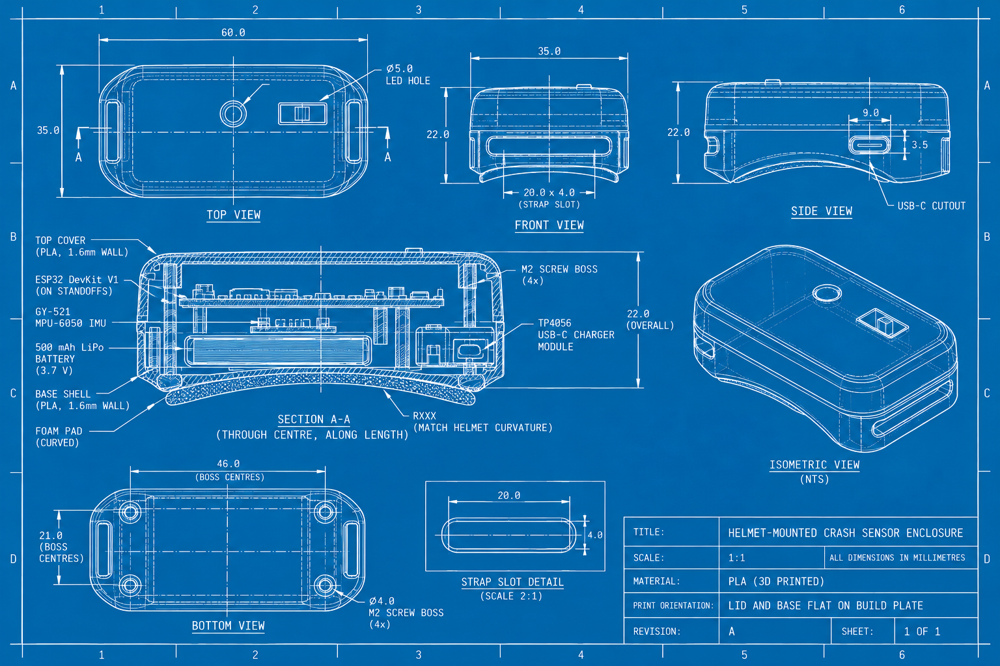
</p>
<p align="center"><sub>Left: exploded view, PLA lid with LED window and switch, ESP32, MPU-6050, LiPo, USB-C charger, PLA base with strap slots. Right: enclosure drawing, 60 x 35 x 22 mm, 1.6 mm walls, four M2 bosses.</sub></p>

| Part | Role | Cost |
|---|---|---:|
| ESP32 DevKit V1 | ESP-WROOM-32, Bluetooth LE to the phone, 100 Hz | HK$40 |
| GY-521 (MPU-6050) | Six-axis accelerometer and gyroscope, 16 g range | HK$15 |
| 500 mAh LiPo, 3.7 V | A full riding day on one charge | HK$25 |
| TP4056 USB-C module | Charging and battery protection | HK$10 |
| Slide switch, 5 mm LED, jumpers | Power, status light, wiring | HK$10 |
| PLA enclosure, two parts | About 25 g of filament | HK$5 |
| Elastic strap | 20 x 4 mm slots | HK$5 |
| **Total** | | **HK$110** |

<sub>Retail prices in Sham Shui Po, October 2026. At a thousand units the board and sensor roughly halve.</sub>

**Bluetooth protocol.** Service `6d657472-6963-7300-0000-000000000001`. A stream characteristic notifies 80 bytes, five frames of `uint32 t_ms, int16 ax ay az (milli-g), int16 gx gy gz (0.1 deg/s)`. An impact characteristic reads 1 for ten seconds after a resultant above 6 g. Firmware: [firmware/esp32_helmet](firmware/esp32_helmet/esp32_helmet.ino).

**Phone first.** Riders on foot and bicycle already carry the sensor. The clip is the upgrade for motorbike riders and for platforms that want crash-grade data.

<details>
<summary>Earlier concept: custom PCB in a 34 mm puck (superseded)</summary>
<br>
<p align="center">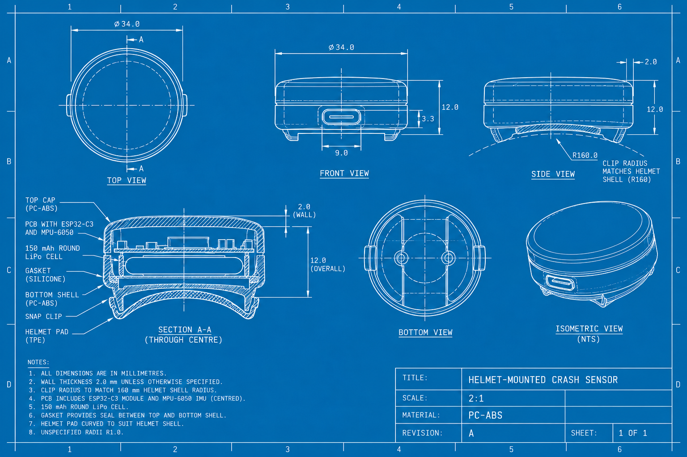</p>
An ESP32-C3 on a custom board. Smaller, but it needs a PCB run we could not do inside the sprint. Kept for the record.
</details>

---

## Market research

<p align="center">
  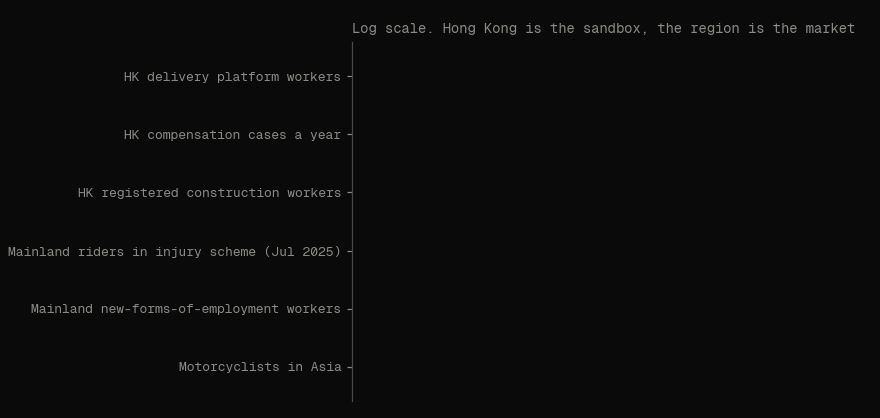
</p>

Hong Kong alone is small, and we say so. It is the right place to set the standard because it is the first common-law jurisdiction legislating no-fault injury cover for platform workers with multi-platform apportionment. The money is across the border.

| Figure | Value | Source |
|---|---|---|
| Delivery platform workers, Hong Kong | ~12,900 people, 18,100 platform jobs | C&SD Thematic Household Survey No. 81[^csd] |
| Order share, Q1 2024 | Keeta 43%, Foodpanda 37%, Deliveroo 20% (left 2025) | China Daily HK[^cdhk] |
| Employees' compensation cases, Hong Kong | 41,254 a year, 244 fatal (2024) | Labour Department[^osh] |
| General liability premiums, Hong Kong | HK$12.1bn gross (2024, provisional) | Insurance Authority[^ia] |
| Registered construction workers, Hong Kong | 667,603 (Dec 2024) | Construction Industry Council[^cic] |
| Mainland new-forms-of-employment workers | 84 million | ACFTU via CGTN[^cgtn] |
| Mainland platform injury scheme | 12.3m covered by Jul 2025, nationwide across 14 platforms from Jul 2026 | Asia Insurance Review, Insurance Business[^air][^ib] |
| Meituan contributions to that scheme | Over 3bn yuan, Jul 2022 to Jun 2026, 10m+ riders | China Daily[^cd] |
| Motorcyclists in Asia | Over 400 million | Insurance Business Asia[^moto] |
| Platform workers worldwide | 150 to 400 million | ILO[^ilo] |
| Parametric insurance market | USD 3.5bn to 21bn (2025), 12 to 14% CAGR | GMI, Mordor[^gmi][^mordor] |

### Three regimes, one missing layer

| Jurisdiction | Platform workers | Injury cover today | What is changing |
|---|---|---|---|
| Hong Kong | ~12,900 | None statutory. Riders are self-employed and outside the Employees' Compensation Ordinance | No-fault statutory regime proposed Jul 2026, platforms liable, apportionment across apps[^lwb][^simmons] |
| Singapore | Not counted here | Platforms must buy work injury insurance since 1 Jan 2025 | Live |
| Mainland China | 84m new-forms workers | National scheme, flat per-order premiums, manual claims | Nationwide from Jul 2026[^ib] |

Three jurisdictions moved in 18 months. None of them has event-level verification. That is the layer we build.

**Why not other groups.** Domestic helpers already sit inside the compensation system: employers must insure them by law. Van drivers usually have an employer and a vehicle with its own black box. The uncovered group is the self-employed two-wheeler worker, which is exactly who the Hong Kong, Singapore and mainland rules target. Full reasoning in [docs/research/MARKET_REFRAMING.md](docs/research/MARKET_REFRAMING.md).

---

## Business model

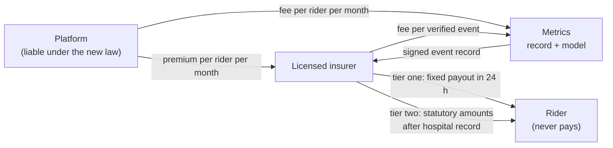

| | Hong Kong pilot | One large platform |
|---|---|---|
| Riders | ~15,000 | ~10 million |
| What it pays for | A sandbox licence and the pilot | A business |
| Revenue | Low single-digit HK$ millions a year | Modelled in [INSURANCE_MODEL.md](docs/research/INSURANCE_MODEL.md) |

**Parametric trigger.** A verified event (model above threshold, rider on shift, no cancel in 30 s) pays a fixed tier one amount within 24 hours, placeholder HK$8,000, about two weeks of median rider income. Hospital admission unlocks tier two at the statutory amounts in the proposed regime. The false alarm rate comes straight from the detector's precision, which is why the model matters to the business case.

### Risk register

| Risk | Likelihood | Impact | Answer |
|---|---|---|---|
| Platforms refuse a record that proves injuries | Medium | High | They are liable either way. Verified events lower premiums, settle apportionment and defend against misattributed claims |
| Riders do not trust it | Medium | High | Rider owns the raw data, opts in per shift, one tap to withdraw, no account, no risk score |
| Mainland platforms will not buy from a Hong Kong team | High | Medium | The standard travels through insurers and reinsurers that operate across the border |

---

## Privacy and governance

The rider owns the raw data and the record. Platforms and insurers read events for the jobs they are liable for, never routes. These are rules enforced in the schema, mapped to the six data protection principles of the Personal Data (Privacy) Ordinance (Cap. 486).

| Data | Lives where | Who sees it |
|---|---|---|
| Raw IMU, GPS trace, speed | Rider's phone and clip, rolling 6 s buffer | Rider only |
| Heat band, fatigue index | Computed on the phone | Rider, as an alert |
| Event record | Server, after 30 s of silence | Rider, liable platform, insurer, and a court on request |
| Hazard cells | Server, 50 m grid, no rider id | Transport Department and platforms, public in aggregate |

No per-rider risk score exists anywhere in the system. Full mapping in [docs/research/GOVERNANCE.md](docs/research/GOVERNANCE.md).

---

## Evidence base

Peer-reviewed sources behind the design. Full table with where each one is used: [docs/research/EVIDENCE_TABLE.md](docs/research/EVIDENCE_TABLE.md).

| # | Source | What we take from it |
|---|---|---|
| 1 | Casilari et al. UMAFall. *Procedia Computer Science* 2017;110:32-39 | Training data |
| 2 | Santoyo-Ramon et al. *Sensors* 2018;18(4):1155 | Phone IMU fall detection by sensor position |
| 3 | Sucerquia et al. SisFall. *Sensors* 2017;17(1):198 | Second dataset, future work |
| 4 | Bagala et al. *PLoS ONE* 2012;7(5):e37062 | Simulated falls overstate real-world sensitivity |
| 5 | Rowson and Duma. *Ann Biomed Eng* 2013;41(5):873-882 | Head acceleration and concussion probability, triage bands |
| 6 | Zhang, Yang and King. *J Biomech Eng* 2004;126(2):226-236 | Mild TBI acceleration thresholds |
| 7 | Liu et al. *Cochrane Database Syst Rev* 2008 | Helmets reduce head injury and death |
| 8 | Steadman. *J Climate Appl Meteorol* 1984;23:1674-1687 | Apparent temperature for the heat band |
| 9 | Christian et al. *J Appl Psychol* 2009 | Time pressure and fatigue as injury risk factors |
| 10 | Williamson et al. *Accid Anal Prev* 2011;43(2):498-515 | Hours on task and crash risk, fatigue index |
| 11 | Christie and Ward. *J Transport and Health* 2019;13:115-127 | Gig riders: time pressure, long hours, crash exposure |
| 12 | Lin et al. E-bike courier road safety, cross-sectional study | 91% overspeeding, 65 to 73% helmet use |

---

## Repository layout

```
.
├── web/                  Next.js 16 app on Vercel: landing, /demo, /rider, /dispatch,
│   │                     /underwriter, /record, /poster, API routes
│   ├── src/lib/          detector, feature port, record schema, signer, store, tests
│   └── scripts/          production validation script
├── ml/                   detector training: UMAFall loader, synthetic rider set, export
│   └── out/              results, model.json, out-of-fold predictions, parity data
├── firmware/             ESP32 helmet sketch and Bluetooth protocol
├── hardware/             enclosure drawing, exploded view, superseded concept
├── validation/           drop test protocol and runs
├── docs/
│   ├── research/         evidence table, market, insurance model, governance, judges, ordinances
│   ├── submission/       150-word proposal, video plan and script, captions, Q&A prep
│   ├── assets/           README graphics and the script that draws them, photos
│   ├── CONTEXT.md        hackathon rules, judging criteria, team, idea history
│   ├── IMPLEMENTATION_PLAN.md
│   └── briefing-deck.pdf
└── .github/workflows/    tests and build on every push
```

## Run it locally

```bash
# web app
cd web
pnpm install
pnpm dev            # http://localhost:3000
pnpm test           # detector, feature parity and store tests
pnpm build

# detector
cd ml
pip install -r requirements.txt
python3 train.py    # writes ml/out, then copy the four JSON files to web/src/lib/ml
python3 test_pipeline.py

# README charts
python3 docs/assets/readme/make_charts.py
```

Without environment variables the app keeps state in memory and generates a signing key per process, which is fine locally. Production uses Upstash Redis and a fixed Ed25519 key. See [web/README.md](web/README.md).

## Stack

| Layer | Tools |
|---|---|
| Web | Next.js 16, React 19, Tailwind 4, MapLibre GL, three.js |
| Backend | Next.js route handlers on Vercel, Upstash Redis, Node `crypto` Ed25519 |
| ML | Python, scikit-learn HistGradientBoosting, PyTorch for the MLP and CNN baselines, model exported to JSON, TypeScript inference |
| Hardware | ESP32, MPU-6050, Arduino, Web Bluetooth |
| Data feeds | Hong Kong Observatory current weather |

## Team

| | Pillar | Role |
|---|---|---|
| Karina Kalicka-Molin | Engineering | ML, software |
| Simone Copetti | Engineering | ML, software |
| Hannes Ganske | Natural sciences | Hardware, CAD, electronics |
| Maalon Jochmann | Medicine and health | Legal and regulatory research, trauma triage |
| Alysa de Haas | Business | Business case, insurance mechanism |

## Key dates

| Date | |
|---|---|
| 25 Oct 2026, 23:59 HKT | Submission deadline |
| 14 Nov 2026 | Grand Final, HKSTP Data Technology Hub, Tseung Kwan O |

## License

Code is released under the [MIT License](LICENSE). Datasets keep their original licences. UMAFall is not redistributed here.

---

[^lwb]: Labour and Welfare Bureau, *Proposed work injury protection for digital platform delivery workers*, LegCo paper, July 2026. RTHK, 10 Jul 2026: https://news.rthk.hk/rthk/en/component/k2/1861808-20260710.htm
[^simmons]: Simmons and Simmons, *HK proposes work injury compensation regime for platform workers*: https://www.simmons-simmons.com/en/publications/cmrsvfcev004wtr54meqgtw0t/hk-proposes-work-injury-compensation-regime-for-platform-workers
[^csd]: Census and Statistics Department, *Thematic Household Survey Report No. 81*, March 2025 (fieldwork Dec 2023 to Mar 2024). Reported in China Daily HK: https://chinadailyhk.com/article/607159
[^cdhk]: China Daily HK: https://chinadailyhk.com/article/607159
[^hro]: Human Resources Online, *Hong Kong High Court finds Foodpanda liable*: https://www.humanresourcesonline.net/hong-kong-high-court-finds-foodpanda-liable-orders-hk-1-3mn-compensation-to-rider-injured-during-typhoon
[^union]: 2024 union survey on rider compensation. The original publisher is being traced and the figure will be removed if it cannot be confirmed.
[^osh]: Labour Department, *Occupational Safety and Health Statistics 2024*: https://www.labour.gov.hk/common/osh/pdf/OSH_Statistics_2024_en.pdf
[^ia]: Insurance Authority press release, 25 Apr 2025: https://www.ia.org.hk/en/infocenter/press_releases/20250425.html
[^cic]: Construction Industry Council, *Figures at a Glance 2024*: https://www.cic.hk/files/page/10499/3.%20Figures%20at%20a%20Glance%20in%202024.pdf
[^cgtn]: CGTN, *84m workers in new job types*: https://news.cgtn.com/news/2023-04-08/84m-workers-in-new-job-types-drive-focus-on-labor-social-security-1iPO16fb5II/share_amp.html
[^air]: Asia Insurance Review: https://asiainsurancereview.com/News/ViewNewsLetterArticle/id/92197/Type/eDaily
[^ib]: Insurance Business Asia, *China extends gig worker injury scheme nationwide*: https://www.insurancebusinessmag.com/asia/news/breaking-news/china-extends-gig-worker-injury-scheme-nationwide-581407.aspx
[^cd]: China Daily, July 2026: https://global.chinadaily.com.cn/a/202607/03/WS6a476a25a310986e2b463676.html
[^moto]: Insurance Business Asia, *Smart helmets to make insurance unique for each motorcyclist*: https://www.insurancebusinessmag.com/asia/news/breaking-news/smart-helmets-to-make-insurance-unique-for-each-motorcyclist-74931.aspx
[^ilo]: People Matters, *ILO adopts first global labour standard for platform economy workers*: https://sea.peoplemattersglobal.com/news/economy-policy/ilo-adopts-first-global-labour-standard-for-platform-economy-workers-51343
[^gmi]: Global Market Insights, parametric insurance market: https://www.gminsights.com/industry-analysis/parametric-insurance-market
[^mordor]: Mordor Intelligence, parametric insurance market: https://www.mordorintelligence.ar/industry-reports/parametric-insurance-market
[^umafall]: Casilari E, Santoyo-Ramon JA, Cano-Garcia JM. UMAFall: A Multisensor Dataset for the Research on Automatic Fall Detection. *Procedia Computer Science* 2017;110:32-39.
[^bagala]: Bagala F et al. Evaluation of Accelerometer-Based Fall Detection Algorithms on Real-World Falls. *PLoS ONE* 2012;7(5):e37062.
[^rowson]: Rowson S, Duma SM. Brain Injury Prediction. *Annals of Biomedical Engineering* 2013;41(5):873-882.
[^zhang]: Zhang L, Yang KH, King AI. A Proposed Injury Threshold for Mild Traumatic Brain Injury. *J Biomech Eng* 2004;126(2):226-236.
